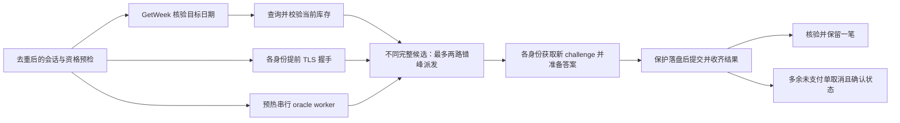

# 三账号流水线：已实现部分与实验方案

2026-11-08用户已明确批准两路：最多2笔在途或临时订单，每笔≤24元，临时合计≤48元，最终保留1笔。TLS提前握手和两路协调器已实现；历史预测和challenge提前获取尚未启用。11月9日首个真实放票窗口已完成两路提交与重复单取消核验，结果见文末；单次闭环成功不证明成功率提升。

## 当前实现的依赖图

当前实现使用一次已校验的库存快照派生不同候选。独立库存观察者、历史预测直订与提前获取challenge均未启用；下文涉及它们的段落仅讨论候选方案。

## TLS 提前握手：已实现

- 配置 OrderTLSPreconnect（缺省 false）。book 在校正后的释放时刻前 750ms 为已通过预检、去重的账号各启动一次握手，握手最长 2 秒；不等待全部握手完成才开始库存查询。
- 握手不向平台发送 HTTP、Cookie、challenge 或订单；使用 HTTP 代理时先按当前配置建立 CONNECT 隧道，保留代理认证和连接头。每条连接仅供所属 Client 的一次 HTTP/1.1 请求使用，未使用最多保留 5 秒。
- 连接尚未就绪、过期、不支持的代理类型或自定义传输：沿用原有冷连接。取消预热会关闭未使用连接和正在进行的握手。
- 已选择预热连接后失败，不能自动冷连接重发该订单；结果按原有未知订单保护处理。
- 下单仍使用一个全新的 HTTP Transport、禁用 keep-alive 和 HTTP/2。底层 TCP/TLS 已经准备好，但此前没有 HTTP 交换，不进入复用连接的自动重试路径。
- Go 可能再次调用已完成的 HandshakeContext，并产生接近零耗时的 TLS trace 回调；不能据此断言发生第二次网络握手。测试同时核对连接数、单次写出、丢响应不重发。
- 预演：`booking.exe -config booking.json -mode tls-preview`。只读会话预检后，握手、等待 750ms，再通过该连接查询 CheckUserStatus。写入 latest-tls-preview.json，不覆盖 latest.json，不创建或取消订单。
- 事件 order_tls_preconnect / order_tls_preconnect_consumed 分别记录握手耗时、状态与消费时连接年龄，不记录地址或凭证。

当前 750ms 提前量、5秒最大保留时间只是工程参数，不是实测服务器空闲超时。真实只读预演不证明中午高峰连接仍能存活。

## 在前一请求尚未返回时，后一个请求怎么决定

需要分清三种状态：尚未发送、在途、已确认结果。历史预测只决定尚未发送请求的候选与发出时机，不能把在途请求解释为失败。服务端可能早已占场，只是响应尚未到达。

1. 准备并行、提交串行：观察者、TLS、候选模板及经验证可提前获取的 challenge 可重叠；仍只允许一个在途订单，无法完全消除等待上一账号结果的瓶颈。
2. 有界错峰竞速：A 发出后，到了间隔 delta 仍无成功/未知/明确限流等停止信号，且临时持有额度足够，才发出 B。C 根据首帧库存更新候选，在并发额度允许时接替。delta 是实验变量，不是根据一次响应测出的阈值。
3. 三账号同时提交：最早发出全部请求，但无法利用稍后到来的首帧，也可能同时产生三笔订单。先验证两路有界竞速更容易分辨收益和收尾成本。

共享故障会使账号响应相关；多账号不能消除平台公共队列，也不能用换账号绕过明确限流。必须记录账号、发出时刻、响应时刻与结果，积累样本后才能比较错峰间隔。

## 共享库存快照

观察者发布带目标日期、采集时刻、版本号和价格校验结果的快照。只更新尚未发送的候选，不修改在途请求；预测模板也要有可靠的日期、场地、时段和价格来源。

首帧可能很有价值，但“第二帧已无价值”仍是待验证假设。可能存在发布延迟、首帧业务繁忙、缓存或稍后释放。第一帧优先，后续保留原有有界低频观察及故障诊断，不能把第一次空结果直接当作永久售空。

观察者与下单账号是否共享服务端会话锁、库存是否对身份有差异，目前未知。实现共享快照时不能假设这些差异不存在。每个账号自己的资格、额度及 challenge 仍独立。

## challenge 提前准备

已保存的官方页面在用户选好场地之后调用 GetFieldSliderCaptcha；当前请求参数中没有场地/时段。客户端参数支持探讨提前获取，但不能由此证明服务端不绑定会话状态。

此项研究已暂缓，未启用。若以后恢复，可单独验证短暂重叠：在首帧库存请求期间准备同账号 challenge，提交前重新确认关联与截止时间。跨账号复用、重复使用、长期储存都不是这个方案。
需要分开验证：有效期、同账号新挑战是否替换旧挑战、放票前后是否有状态变化、空候选如何丢弃、会话刷新是否使挑战失效。只读预演只能证明页面/接口能返回挑战，无法证明延迟后的真实提交会被接受。

本轮没有提前获取真实 challenge 或改变 solver。此前候选确定到提交约78ms，其中挑战接口15ms、oracle11ms，其余为本地处理和保护落盘；不能把全部78ms都算作可被提前准备消除的时间。

## 离线实践与上线条件

运行 `python -X utf8 -m booking_tools.pipeline_lab --compact`。模型无网络、无凭证，使用合成场地和分离的服务端提交/响应时刻，比较 serial、prepared_serial、hedge。它不模拟真实平台成功率、完整持久化恢复或动态价格。

一个人为场景：库存480ms，A/B/C响应900/450/300ms，错峰150ms、最多两路在途。查库存串行首次成功1467ms，预测但串行987ms，两路错峰687ms。两路模式可能瞬时持有2笔，取消确认后剩1笔；响应丢失或取消未确认时保持待核对。这些数字解释机制，不是下一轮成功率预测。

模型测试覆盖：晚到成功、未知响应、取消未确认、首帧库存过时、同目标相关失败、观察者只影响未发请求、两路/三路持有上限。

已实现逐尝试持久化账本、成功/未知停止新派发且排空在途结果、最终赢家选择、多余未支付单取消核验、崩溃恢复与故障回放。共享保护保留，各次提交另存收据。每个 Client 同时只执行一个业务请求，oracle 的 stdin/stdout 由互斥队列串行交接；调度器统一管理在途额度和账本。独立库存观察者仍未实现，若以后引入，应独立持有请求状态。

推荐首次真实范围：最多2笔在途/临时持有，每笔原预算24元、临时金额合计最多48元，最终只保留1笔最多24元；第三账号保留接替资格。用户已于2026-11-08回复“两路吧”批准该范围。三路和72元临时上限未获批准。

## 网络实现参考

[Go Transport](https://pkg.go.dev/net/http#Transport) 的 DialTLSContext 接受已完成握手的连接；本机 Go 1.27.2 源码和丢响应测试用于核验新连接不自动重试的行为。真正收益要以预热消费事件和正式窗口的请求阶段数据确认。

## 2026-11-08 实际只读预演

第一次发现本机HTTP代理使直连预热被跳过；补齐原代理CONNECT路径并再次完整测试后，预演成功。预握手216.393ms，连接闲置751.196ms，预热连接上的CheckUserStatus为98ms，查询阶段TLS trace为0ms、单次写出。握手事件中的一次writeAttempts来自代理CONNECT，不是平台业务请求。全轮8次只读请求，0次challenge、0次下单、0次取消。该预演验证了本机代理路径和连接交接；11月9日正式窗口的观察见下文。

## 两路生产协调器（2026-11-08）

配置 ParallelOrders=2、MaxTemporaryCents=4800、ParallelStaggerMillis=150。错峰150ms为初始实验参数，不是测出的服务器阈值。默认示例保持串行，真实配置独立启用。

- 放票窗口和GetWeek校验不变；先得到完整两小时候选列表。首版共享这一份快照，A/B选择不同候选，每个身份本轮最多提交一次，最多使用3个已验证身份。只有一个候选时只提交一笔。
- 最多两路在途；明确场地占用后保持原PollSeconds间隔再让第三身份接替。成功、未知、明确限流、繁忙或其他异常均停止新派发。停止新派发不丢弃已发请求的结果。
- 每次启动worker前将意图写入runtime/orders原共享保护文件；每笔原始结果另存runtime/parallel/目标日期/attempt-N。原共享保护不删除，切回串行也不能重新下单。
- 接收完在途结果后，核验日期、场地、时段、价格和状态。优先保留首先响应成功且通过核验的一笔；对多余未支付单只发一次取消请求，必须读到PayStatus=4才记为取消成功。
- 正常提交截止后仅留最长30秒收尾，不延长下单窗口。未知订单、无法核验、取消未确认或额外订单已支付时保留保护并通知人工核对，不声称已满足最终一笔。
- oracle的JSON交接使用互斥串行小队列，两个账号的网络等待可以重叠，不会串错token。每个Client在同一时刻只有一个业务调用；日志写入串行化。
- 重启收尾命令：booking.exe -config booking.json -mode reconcile-parallel -order-date YYYY-MM-DD。只读取原账本和每笔收据，核验已知订单并收尾，不创建订单。没有OID的未知尝试需先核对官方订单列表，不能自动重发。取消状态不明的请求不会再次取消，只查询最终状态。
- 本地回放覆盖两路重叠、晚到成功、取消响应丢失、取消未确认、成功阻止B、明确占用后C接替、限流阻止C、截止排空、跨进程收据恢复、未写收据的崩溃保护和共享oracle回复关联。

当前继续使用已校验的实时库存和每次新获取的challenge。150ms是任务派发间隔，实际订单HTTP间隔还受挑战响应、队列与本地落盘影响。

## 2026-11-09 首次真实放票窗口

两路均返回成功并核验为同场连续两小时、每笔24元。先响应成功的一笔保留，多余未支付单只取消一次，并读取最终 PayStatus=4；临时最多两笔/48元，最终一笔/24元。没有使用第三身份，没有未知结果或HTTP 429。

| 指标 | 本次观察 |
| --- | --- |
| 当前库存查询 | 15ms，7个完整两小时候选 |
| 两路任务派发间隔 | 157.580ms（配置150ms） |
| 两笔订单HTTP请求开始间隔 | 217.917ms |
| 两笔订单HTTP请求重叠 | 约647.083ms |
| 订单响应耗时 | 865ms / 1192ms |
| 提交阶段TLS耗时 | 两笔均为0ms，已消费各自预热连接 |
| oracle启动 / 两次响应 | 放票前800ms / 12ms、7ms |
| 校正后的触发至全部核验收尾 | 约1966.688ms |

HTTP耗时日志采用整毫秒，响应结束和重叠时间据此估算。HTTP Date只是低精度时差参考，不能把本地早于12点的日志当作提前放票证据。

本次证明两路流程在一个真实窗口中完成了闭环。第一路自身已经成功，第二路没有挽救失败，因此不能据此声称池化提高成功率；供给、网络、负载及相对旧人工流程的其他改动也是混杂因素。后续保持参数，积累可比窗口。原始会话、挑战、订单号和运行日志仅留本机。
